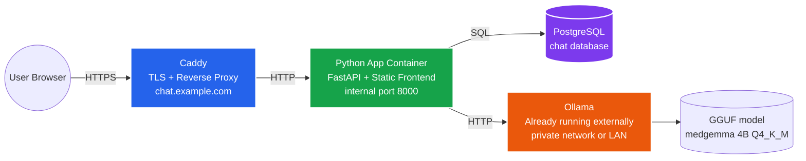
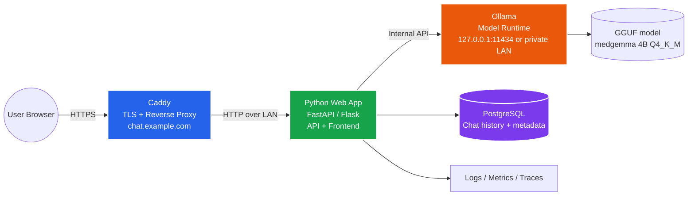
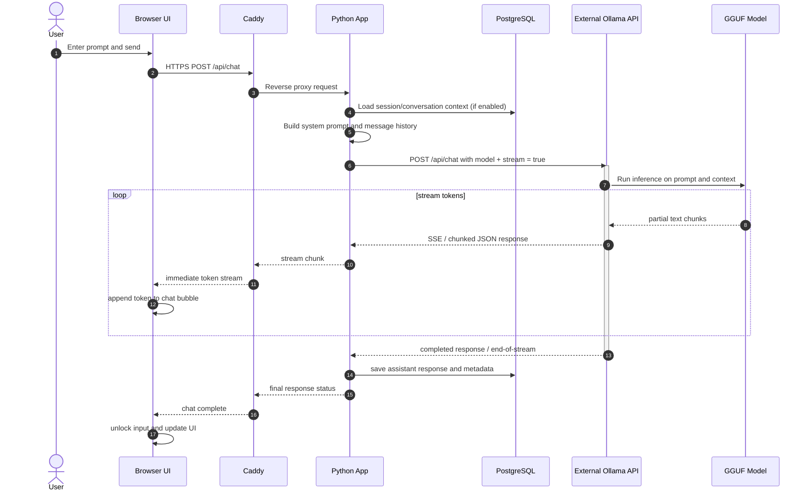
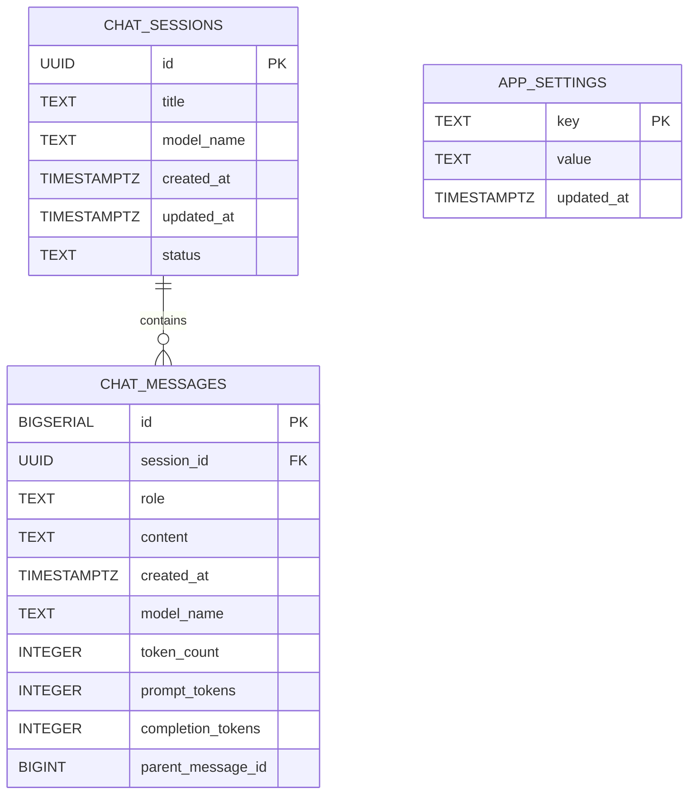
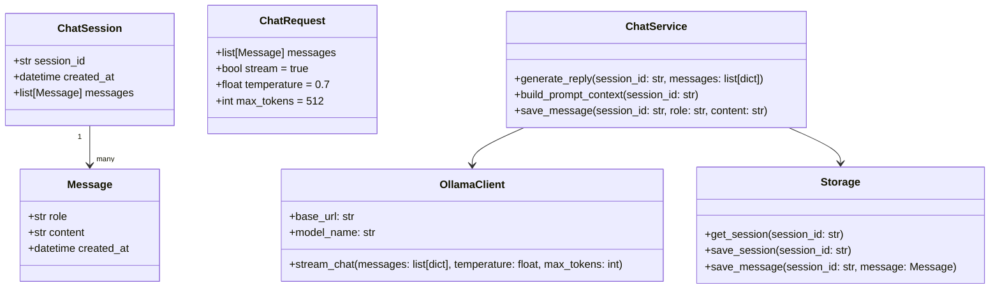
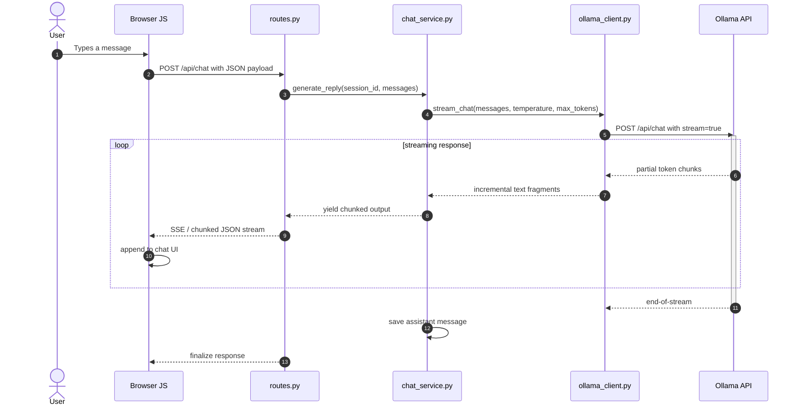
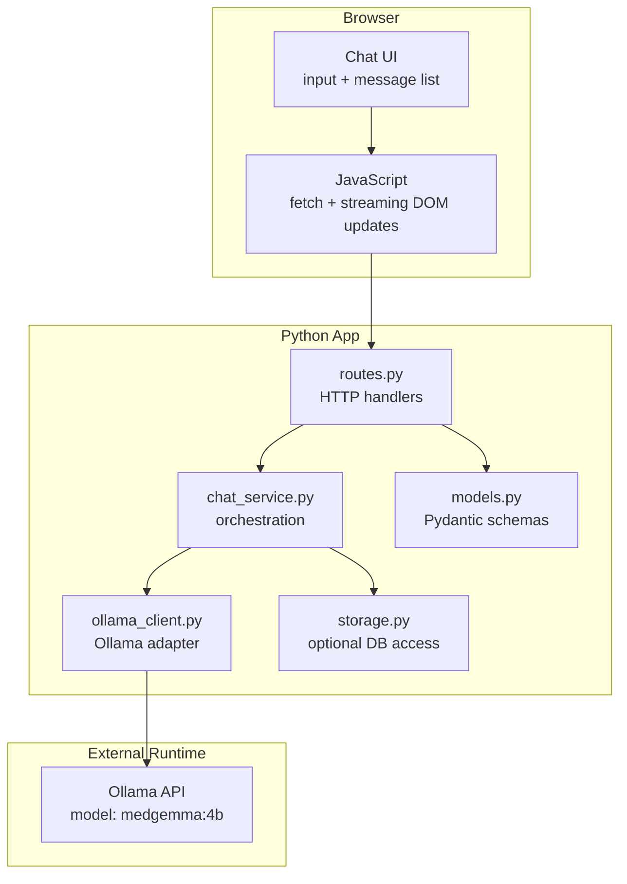

# Architecture Specification: Self-Hosted MedGemma AI Chat

## 1. Executive Summary

This architecture describes a self-hosted web chat application that exposes a browser-based chat UI to users while running a local LLM through Ollama. The target deployment uses:

- a public edge box running Caddy for TLS termination, subdomain routing, and reverse proxying, but with Caddy setup handled separately after the app is working
- a single Docker Compose deployment on the app host with a Python service and PostgreSQL service
- an external Ollama runtime that is already installed and running outside Docker
- persistent local storage for chat histories and app settings

The goal is to keep the model runtime local, the public attack surface small, and the application easy to extend for future features such as authentication, file uploads, conversation history, or multi-user access.

---

## 2. Docker Compose Deployment Layout

For the proof of concept, the app should run in Docker Compose on the internal app box. This gives a straightforward, portable setup with a dedicated PostgreSQL container and a Python web app container. Ollama is not part of the Compose file for this version and is expected to be already running externally.



Required Docker services for the initial version:

- `app`: Python app serving the frontend and API
- `db`: PostgreSQL for chat sessions and messages

External runtime not managed by Compose:

- Ollama: already installed and running elsewhere
- Caddy: configured separately on the edge box when the app is ready to receive a public subdomain

---

## 3. Deployment Topology

For the first version, the simplest and most practical setup is a single Docker Compose stack on the app host:

1. Public edge host (Caddy)
   - Handles `chat.example.com` or similar
   - terminates TLS with Let's Encrypt
   - proxies traffic to the app backend after the app is working
   - is intentionally out of scope for the initial implementation

2. App host (Python + Docker Compose)
   - runs the web frontend and API in one container
   - serves HTML/JS to the browser
   - handles chat session state and request orchestration
   - calls Ollama over HTTP using a configured external host/port
   - uses PostgreSQL for persistence

3. External model host (Ollama)
   - runs the GGUF model outside Docker
   - exposes its API on a private network port or local host address
   - is not directly exposed to the internet

This keeps the model and its weights behind a private boundary and keeps the POC focused on a working chat flow rather than infrastructure complexity.



---

## 4. Core Components

### A. Public Edge Gateway (`Caddy`)

Responsibilities:

- TLS termination for the public host
- reverse proxy to the internal application host
- subdomain routing such as `chat.example.com`
- automatic certificate management with Let's Encrypt
- basic security hardening such as HSTS, security headers, and request limits

Recommended Caddy behaviors:

- disable direct exposure of the Ollama port
- only expose the web app endpoint to the public
- configure upstream timeouts for long-running generations
- use a `reverse_proxy` stanza to the app service

Important detail: the model runtime should never be directly reachable from the internet.

### B. Web Application (`Python`)

Best choice: `FastAPI` in Python.

Why it fits well:

- clean async request handling
- native support for streaming responses
- straightforward JSON API for frontend chat
- easy integration with OpenAI-compatible/LLM APIs
- ideal for SSE-based streaming UIs

The web app should be responsible for:

- serving the browser app and static assets
- receiving chat requests from the browser
- validating payload shape
- adding system prompts or safety instructions
- calling the external Ollama API using a configured endpoint
- streaming tokens back to the browser
- persisting chat history and metadata in PostgreSQL

A simple PHP app could also work, but Python is more natural for streaming and LLM integration.

### C. LLM Adapter Layer (`Ollama`)

This layer abstracts the actual model runtime from the web app. The app should not talk to the model directly in a ad hoc way; it should call a stable local API contract.

Responsibilities:

- load and serve the selected model
- manage generation parameters such as temperature, context size, and stop sequences
- handle streaming completion output
- expose an HTTP API that the app uses

The target model should be represented as a local tag or a pinned model reference, for example:

- a locally tagged model name such as `medgemma:4b`
- or a custom alias managed by the Ollama runtime

If the exact `hf.co/...` identifier is not directly accepted in your Ollama version, a local `Modelfile` or alias is a safer route. For this project, the alias approach is preferred and should be controlled by configuration rather than hardcoded in the app.

### D. Persistence Layer (`PostgreSQL`)

For a proof of concept, PostgreSQL is a strong choice because it is small to set up, reliable, and easy to evolve.

The database should store:

- conversation sessions
- message history
- timestamps and metadata
- current model metadata
- optional app settings and future configuration values

This is strongly recommended even for a POC because it makes the app feel more real and is easy to extend later.

Suggested PostgreSQL tables:

- `chat_sessions`
- `chat_messages`
- `app_settings`

The database should not store authentication-sensitive data in the first version because auth is intentionally out of scope. The schema is intentionally minimal but forward-looking for future multi-user and multi-session support.

---

## 5. Detailed Request Flow

Below is the more realistic flow for a web chat request.



This flow is the crucial part for performance. A slow or buffered proxy can ruin the real-time chat experience, so the stream should remain as close to real-time as possible.

---

## 6. Suggested Frontend Design

The browser should have a lightweight chat interface with a minimal state model.

Recommended UX elements:

- message list view
- input box with send button
- streaming response rendering
- loading indicator while generation is active
- error state for connection or model issues
- optional conversation history sidebar

Frontend technologies:

- plain HTML + JavaScript is enough for a basic version
- React or Vue if the app grows
- HTMX or a minimal JS framework if you want simple server-rendered pages

For a small self-hosted app, a plain JavaScript frontend is often easier than a larger SPA.

---

## 7. API Contract

A minimal API contract should look like this.

### POST /api/chat

Request body:

```json
{
  "messages": [
    {"role": "user", "content": "Explain how this works"},
    {"role": "assistant", "content": "Sure — here is the explanation..."}
  ],
  "stream": true,
  "temperature": 0.7,
  "max_tokens": 512
}
```

Response:

- stream of chunks with text deltas
- or a final JSON response if streaming is disabled

For streaming, the backend should forward tokens in a browser-friendly format such as SSE or chunked JSON, so the UI can append them incrementally.

### Optional endpoints

- `GET /api/health` — model and app liveness/check
- `GET /api/models` — list available Ollama models
- `POST /api/session` — create or resume conversation
- `GET /api/history` — retrieve prior chat messages

---

## 8. PostgreSQL Database Design

The database should be intentionally small at first. The basic schema is enough to support a chat application with multiple conversation sessions and persisted messages.

### 7.1 Proposed Tables

#### `chat_sessions`

Represents a single conversation thread.

| Column | Type | Purpose |
| --- | --- | --- |
| id | UUID / TEXT PRIMARY KEY | Unique session identifier |
| title | TEXT | Optional first message summary or title |
| model_name | TEXT | Model used for this session |
| created_at | TIMESTAMPTZ | Creation timestamp |
| updated_at | TIMESTAMPTZ | Last activity timestamp |
| status | TEXT | Active, archived, or closed |

#### `chat_messages`

Stores each user and assistant message in a session.

| Column | Type | Purpose |
| --- | --- | --- |
| id | BIGSERIAL PRIMARY KEY | Unique message ID |
| session_id | UUID / TEXT FK | Links to session |
| role | TEXT | `user` or `assistant` |
| content | TEXT | Message body |
| created_at | TIMESTAMPTZ | Message timestamp |
| model_name | TEXT | Model used for generation |
| token_count | INTEGER | Optional token estimate |
| prompt_tokens | INTEGER | Optional prompt count |
| completion_tokens | INTEGER | Optional completion count |
| parent_message_id | BIGINT NULL | Optional future threading support |

#### `app_settings`

Stores small application-level settings.

| Column | Type | Purpose |
| --- | --- | --- |
| key | TEXT PRIMARY KEY | Setting name |
| value | TEXT | Setting value |
| updated_at | TIMESTAMPTZ | Last change time |

### 7.2 Database UML



This diagram captures the minimum schema needed for the first version, without introducing user tables or auth models too early.

---

## 9. Python Application Structure

The application should be organized into a small set of modules with clear responsibilities. A simple but maintainable structure is: 

```text
app/
  main.py                  # app startup and configuration
  config.py                # environment settings and model config
  models.py                # request/response schemas and data types
  ollama_client.py         # HTTP client for Ollama
  chat_service.py          # orchestration logic for prompt + response flow
  storage.py               # optional DB access for conversation history
  routes.py                # FastAPI routes for web + API endpoints
  templates/
    index.html
  static/
    styles.css
    app.js
```

This separation keeps the app easy to test: the HTTP layer, business logic, storage layer, and external model provider are isolated.

### 9.1 `main.py`

Responsibilities:

- initialize the FastAPI app
- load environment variables
- register routes
- mount static files if needed
- expose the app on a defined port

Example responsibilities:

- create the `FastAPI()` instance
- configure CORS if the frontend is served separately
- configure logging
- attach the app lifecycle if needed

### 9.2 `config.py`

Responsibilities:

- load config values from environment or `.env`
- centralize model name and network settings
- define defaults for generation parameters

Suggested configuration values:

```python
OLLAMA_BASE_URL = "http://ollama-host:11434"
MODEL_NAME = "medgemma:4b"
TEMPERATURE = 0.7
MAX_TOKENS = 512
NUM_CTX = 4096
REQUEST_TIMEOUT_SECONDS = 120
```

This makes it easy to change the model or endpoint later without rewriting the code paths.

### 9.3 `models.py`

Responsibilities:

- define the request and response data structures
- model the conversation payload sent to the backend and the LLM
- make the API contract explicit and easy to validate

Example Pydantic models:

```python
from pydantic import BaseModel, Field
from typing import List, Optional

class Message(BaseModel):
    role: str
    content: str

class ChatRequest(BaseModel):
    messages: List[Message]
    stream: bool = True
    temperature: float = 0.7
    max_tokens: int = 512

class ChatResponse(BaseModel):
    message: Optional[str] = None
    status: str = "ok"
    error: Optional[str] = None
```

These models help validate the browser request before it is forwarded to Ollama.

### 9.4 `ollama_client.py`

Responsibilities:

- construct the HTTP request to Ollama
- send the model name, prompt messages, and generation settings
- handle streaming responses from the Ollama API
- parse partial chunks and convert them for the frontend

This layer should manage the provider contract. If the app later switches from Ollama to another backend, only this module changes.

Pseudo-signature:

```python
class OllamaClient:
    def __init__(self, base_url: str, model_name: str):
        self.base_url = base_url
        self.model_name = model_name

    async def stream_chat(self, messages: list[dict], temperature: float, max_tokens: int):
        ...
```

### 9.5 `chat_service.py`

Responsibilities:

- orchestrate the request flow
- build the final prompt payload
- call the client
- add optional system prompts or conversation context
- persist conversation data if enabled

This is the core logic of the app. It acts as the coordinator between the HTTP-facing API, PostgreSQL storage, and the external Ollama integration.

Pseudo-signature:

```python
class ChatService:
    def __init__(self, ollama_client, storage=None):
        self.ollama_client = ollama_client
        self.storage = storage

    async def generate_reply(self, session_id: str, messages: list[dict]):
        ...
```

### 9.6 `storage.py`

Responsibilities:

- persistence for chat sessions and messages
- read and write conversations
- store timestamps and metadata
- support future session retrieval and message listing

For this version, this module should target PostgreSQL via SQLAlchemy or psycopg. The database design is small, so the storage layer should remain simple and explicit.

Example schema idea:

```sql
CREATE TABLE chat_sessions (
    id UUID PRIMARY KEY,
    title TEXT,
    model_name TEXT NOT NULL,
    created_at TIMESTAMPTZ NOT NULL DEFAULT NOW(),
    updated_at TIMESTAMPTZ NOT NULL DEFAULT NOW(),
    status TEXT NOT NULL DEFAULT 'active'
);

CREATE TABLE chat_messages (
    id BIGSERIAL PRIMARY KEY,
    session_id UUID NOT NULL REFERENCES chat_sessions(id) ON DELETE CASCADE,
    role TEXT NOT NULL,
    content TEXT NOT NULL,
    created_at TIMESTAMPTZ NOT NULL DEFAULT NOW(),
    model_name TEXT,
    token_count INTEGER,
    prompt_tokens INTEGER,
    completion_tokens INTEGER,
    parent_message_id BIGINT NULL
);

CREATE TABLE app_settings (
    key TEXT PRIMARY KEY,
    value TEXT NOT NULL,
    updated_at TIMESTAMPTZ NOT NULL DEFAULT NOW()
);
```

### 9.7 `routes.py`

Responsibilities:

- handle browser requests and return HTML or JSON
- expose `/` for the page
- expose `/api/chat` for chat requests
- expose `/api/health` for health checks

The routes should be thin; they should delegate most logic to the service layer and not contain inference logic directly.

---

## 10. Proposed Python Data Model

The Python app can be modeled in terms of a few simple domain objects.



This shows the actual domain model of the app without overcomplicating the design. For a POC, we do not need a large object model; we just need a small set of coherent entities.

---

## 11. App Request Lifecycle UML



This sequence diagram reflects the actual user experience and the technical flow that matters most: the browser should see tokens as they are generated, not after the full answer completes.

---

## 12. Component Interaction UML



This layered view is useful because it keeps the design understandable: browser UI at the top, app business logic in the middle, model integration at the edge.

---

## 13. Simulated Class Responsibilities

The system can be simplified into a few classes and functions that directly mirror the app architecture.

```python
class Config:
    ollama_base_url: str
    model_name: str
    temperature: float
    max_tokens: int
    num_ctx: int

class Message:
    role: str
    content: str
    created_at: datetime

class ChatSession:
    session_id: str
    created_at: datetime
    messages: list[Message]

class OllamaClient:
    def __init__(self, config: Config):
        ...

    async def stream_chat(self, messages: list[dict]):
        ...

class ChatService:
    def __init__(self, ollama_client: OllamaClient, storage=None):
        ...

    async def generate_reply(self, session_id: str, messages: list[dict]):
        ...

class ChatController:
    def __init__(self, chat_service: ChatService):
        ...

    async def chat(self, request: ChatRequest):
        ...
```

This is intentionally small and easy to implement in a first version. It is enough to support the POC without becoming overengineered.

---

## 14. Suggested First-Version File Responsibilities

To keep the project manageable, the first iteration should follow this split:

- `main.py`
  - app startup and setup
- `config.py`
  - model environment config
- `models.py`
  - request/response validation
- `ollama_client.py`
  - communication with Ollama
- `chat_service.py`
  - orchestrates prompt assembly and streaming
- `routes.py`
  - HTTP endpoint definitions
- `index.html`
  - single-page chat UI
- `app.js`
  - browser-side fetch and streaming logic
- `styles.css`
  - minimal UI styling

This structure is small enough to understand quickly while still being realistic for a real app.

---

## 15. Error Handling Model

The backend should handle these cases explicitly:

- Ollama is unavailable
- the model cannot be loaded
- the request payload is malformed
- the stream ends unexpectedly
- generation times out

Recommended behavior:

- return HTTP 503 if the model service is unavailable
- return HTTP 400 for malformed requests
- return a friendly frontend error if the stream disconnects
- log the failure with request metadata for debugging

This makes the app resilient enough to demo without extra infrastructure.

---

## 16. Performance and UX Notes

For a chat app, the user experience depends heavily on streaming.

The backend should avoid buffering large outputs. The browser should render incoming text as it arrives. This reduces perceived latency and makes the interaction feel natural.

The app should also allow:

- message queueing if multiple requests arrive too quickly
- graceful cancellation if a request is interrupted
- simple status indicators while generation is active

---

## 17. Summary

The app architecture should be intentionally simple:

- browser UI sends chat input
- Python app validates and orchestrates the request
- Ollama performs inference
- streamed output is returned to the browser
- Caddy provides public access without exposing the model runtime

The Python code should be broken into a few focused modules, with a small domain model and a clean separation between transport, service, and model adapter logic. That keeps the proof of concept easy to build, test, and extend.

This is a good fit for a first version because it keeps the deployment simple while still being realistic enough to grow into a more robust product later.
- generation length caps

A production-ready deployment should also expose those in app settings rather than hardcoding them in the app source.

Example environment variables:

```bash
OLLAMA_HOST=0.0.0.0:11434
OLLAMA_MODELS=/var/lib/ollama/models
APP_ENV=production
APP_PORT=8000
MODEL_NAME=medgemma:4b
OLLAMA_BASE_URL=http://ollama-private:11434
SESSION_DB_PATH=/data/chat.db
```

---

## 8. Security Considerations

This app should be treated as an internet-facing web service, even if the model itself is local.

Required protections:

- Caddy terminates TLS and is the only public entrypoint
- Ollama remains private and never exposed on the internet
- use HTTPS-only endpoints
- add rate limiting for chat requests
- optionally require authentication for private deployments
- sanitize or validate all prompt data before handing it to the model
- log prompts and responses in a controlled way if data sensitivity matters

Recommended protections for later maturity:

- per-user or per-session auth
- admin controls for model selection
- request quotas / abuse prevention
- moderation layer for harmful prompts
- environment-separated configuration (`dev`, `staging`, `prod`)

---

## 9. Operational Concerns

### A. Long-running generation

The app must handle long model responses without triggering proxy buffering or request timeouts.

Recommended settings:

- Caddy upstream timeouts set appropriately for streaming responses
- disable or reduce buffering where possible
- ensure the browser gets chunks as they arrive

### B. Failure handling

The app should gracefully handle:

- Ollama unavailable
- model load failure
- generation timeout
- proxy interruption
- malformed prompt payloads

The UI should display friendly errors rather than leaving the user hanging.

### C. Logging and observability

At minimum, record:

- request timestamps
- request duration
- model name
- response status
- errors and exceptions
- basic token counts if available

A future improvement could include Prometheus metrics or structured logs for monitoring.

---

## 10. Deployment Recommendation

For your exact setup, the cleanest deployment is:

- Box A: Caddy + public DNS + TLS + reverse proxy
- Box B: Dockerized Python app + optional database
- Box C: Ollama runtime for the local model

The web app should live on the same internal network as the Ollama container and talk to it over a private network or Docker bridge rather than the public internet.

This is more secure and more stable than exposing the LLM process directly to the internet.

---

## 11. Recommended Implementation Path

### Phase 1: Prototype

- Caddy proxies to a local Python API
- FastAPI app exposes `/api/chat`
- Ollama runs the local model on a private port
- browser sends and receives streaming responses
- no auth, no persistence yet

### Phase 2: Usable app

- add conversation history
- add user session support
- add health checks and logs
- add a proper Caddy config with timeouts and security headers

### Phase 3: Production hardening

- add user auth
- add rate limiting and abuse prevention
- add DB-backed history
- add admin dashboard and model controls
- add monitoring and failover capacity

---

## 12. Summary

The current architecture is directionally correct, but it is better framed as a layered service architecture rather than a single monolithic app. The main improvements needed are:

- define the edge/public boundary clearly
- enforce private model runtime access
- add session and persistence layers
- document streaming behavior and timeouts
- include security and operational details
- treat the app backend as the orchestration layer rather than the model itself

For your setup, Python + FastAPI + Ollama + Caddy is a strong architecture and is simpler and more maintainable than a more complex microservice design for a first version.

If you want to evolve this into a real product later, the system can expand from a single chat page into authenticated, multi-user, multi-model deployments without changing the core design.