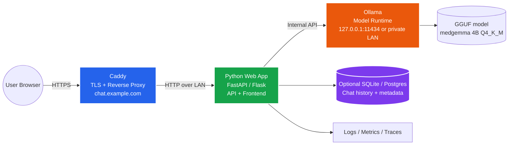
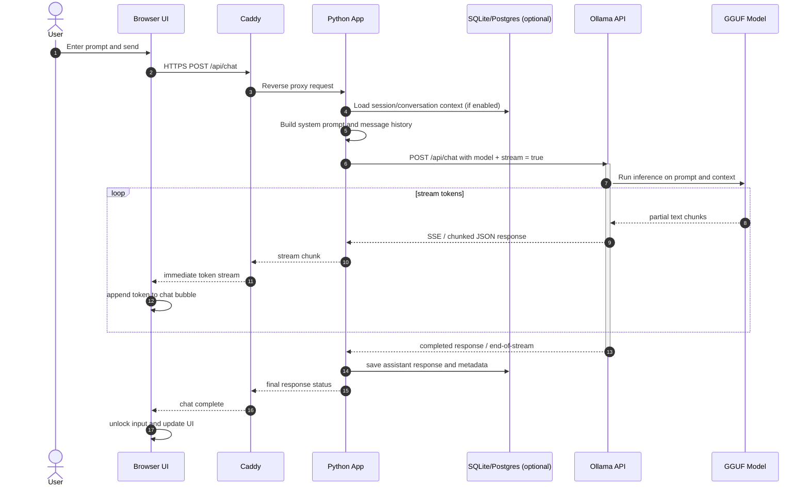

# Architecture Specification: Self-Hosted MedGemma AI Chat

## 1. Executive Summary

This architecture describes a self-hosted web chat application that exposes a browser-based chat UI to users while running a local LLM through Ollama. The target deployment uses:

- a public edge box running Caddy for TLS termination, subdomain routing, and reverse proxying
- an internal application host running Python and Docker
- an inference host running Ollama and the GGUF model
- optional local persistence for chat history and application settings

The goal is to keep the model runtime local, the public attack surface small, and the application easy to extend for future features such as authentication, file uploads, conversation history, or multi-user access.

---

## 2. Recommended Deployment Topology

The most practical setup for this scenario is a two-host or three-host architecture:

1. Public edge host (Caddy)
   - Handles `chat.example.com` or similar
   - terminates TLS with Let's Encrypt
   - proxies traffic to the app backend over the local network
   - applies rate limiting, request timeouts, and security headers

2. App host (Python + Docker)
   - runs the web frontend and API
   - serves HTML/JS to the browser
   - handles chat session state and request orchestration
   - calls Ollama over HTTP

3. Model host (Ollama)
   - runs the GGUF model
   - exposes the local Ollama API on a private network port
   - is not directly exposed to the internet

This keeps the model and its weights behind a private boundary and prevents direct internet access to Ollama.



---

## 3. Core Components

### A. Public Edge Gateway (`Caddy`)

Responsibilities:

- TLS termination for the public host
- reverse proxy to the internal application host
- subdomain routing such as `chat.example.com`
- automatic certificate management with Let's Encrypt
- basic security hardening such as HSTS, security headers, and request limits

Recommended Caddy behaviors:

- disable direct exposure of the Ollama port
- only expose the web app endpoint to the public
- configure upstream timeouts for long-running generations
- use a `reverse_proxy` stanza to the app service

Important detail: the model runtime should never be directly reachable from the internet.

### B. Web Application (`Python`)

Best choice: `FastAPI` in Python.

Why it fits well:

- clean async request handling
- native support for streaming responses
- straightforward JSON API for frontend chat
- easy integration with OpenAI-compatible/LLM APIs
- ideal for SSE-based streaming UIs

The web app should be responsible for:

- serving the browser app and static assets
- receiving chat requests from the browser
- validating payload shape
- adding system prompts or safety instructions
- calling the Ollama API with the model name and generation parameters
- streaming tokens back to the browser
- persisting chat history and metadata if needed

A simple PHP app could also work, but Python is more natural for streaming and LLM integration.

### C. LLM Adapter Layer (`Ollama`)

This layer abstracts the actual model runtime from the web app. The app should not talk to the model directly in a ad hoc way; it should call a stable local API contract.

Responsibilities:

- load and serve the selected model
- manage generation parameters such as temperature, context size, and stop sequences
- handle streaming completion output
- expose an HTTP API that the app uses

The target model should be represented as a local tag or a pinned model reference, for example:

- a locally tagged model name such as `medgemma:4b`
- or the exact Hugging Face-backed model name supported by your Ollama setup

If the exact `hf.co/...` identifier is not directly accepted in your Ollama version, a local `Modelfile` or alias is a safer route.

### D. Persistence Layer (Optional but Recommended)

For even a modest chat app, you will eventually need:

- conversation records
- user/session metadata
- message history
- generated prompt logs or debug traces
- admin metrics or moderation data

A lightweight implementation can use:

- SQLite for a single-node deployment
- PostgreSQL for future multi-user or production needs

This is not strictly required for a minimal prototype, but it becomes important the moment you want chat history, user sessions, or analytics.

---

## 4. Detailed Request Flow

Below is the more realistic flow for a web chat request.



This flow is the crucial part for performance. A slow or buffered proxy can ruin the real-time chat experience, so the stream should remain as close to real-time as possible.

---

## 5. Suggested Frontend Design

The browser should have a lightweight chat interface with a minimal state model.

Recommended UX elements:

- message list view
- input box with send button
- streaming response rendering
- loading indicator while generation is active
- error state for connection or model issues
- optional conversation history sidebar

Frontend technologies:

- plain HTML + JavaScript is enough for a basic version
- React or Vue if the app grows
- HTMX or a minimal JS framework if you want simple server-rendered pages

For a small self-hosted app, a plain JavaScript frontend is often easier than a larger SPA.

---

## 6. API Contract

A minimal API contract should look like this.

### POST /api/chat

Request body:

```json
{
  "messages": [
    {"role": "user", "content": "Explain how this works"},
    {"role": "assistant", "content": "Sure — here is the explanation..."}
  ],
  "stream": true,
  "temperature": 0.7,
  "max_tokens": 512
}
```

Response:

- stream of chunks with text deltas
- or a final JSON response if streaming is disabled

For streaming, the backend should forward tokens in a browser-friendly format such as SSE or chunked JSON, so the UI can append them incrementally.

### Optional endpoints

- `GET /api/health` — model and app liveness/check
- `GET /api/models` — list available Ollama models
- `POST /api/session` — create or resume conversation
- `GET /api/history` — retrieve prior chat messages

---

## 7. Model and Runtime Configuration

At minimum, the model runtime should define:

- model name
- context size (`num_ctx`)
- temperature
- max generation length
- stop sequences if needed
- hardware settings relevant to the machine

For a 4B model like MedGemma, the biggest practical parameters to tune are:

- `num_ctx` (context window)
- `temperature`
- `repeat_penalty`
- generation length caps

A production-ready deployment should also expose those in app settings rather than hardcoding them in the app source.

Example environment variables:

```bash
OLLAMA_HOST=0.0.0.0:11434
OLLAMA_MODELS=/var/lib/ollama/models
APP_ENV=production
APP_PORT=8000
MODEL_NAME=medgemma:4b
OLLAMA_BASE_URL=http://ollama-private:11434
SESSION_DB_PATH=/data/chat.db
```

---

## 8. Security Considerations

This app should be treated as an internet-facing web service, even if the model itself is local.

Required protections:

- Caddy terminates TLS and is the only public entrypoint
- Ollama remains private and never exposed on the internet
- use HTTPS-only endpoints
- add rate limiting for chat requests
- optionally require authentication for private deployments
- sanitize or validate all prompt data before handing it to the model
- log prompts and responses in a controlled way if data sensitivity matters

Recommended protections for later maturity:

- per-user or per-session auth
- admin controls for model selection
- request quotas / abuse prevention
- moderation layer for harmful prompts
- environment-separated configuration (`dev`, `staging`, `prod`)

---

## 9. Operational Concerns

### A. Long-running generation

The app must handle long model responses without triggering proxy buffering or request timeouts.

Recommended settings:

- Caddy upstream timeouts set appropriately for streaming responses
- disable or reduce buffering where possible
- ensure the browser gets chunks as they arrive

### B. Failure handling

The app should gracefully handle:

- Ollama unavailable
- model load failure
- generation timeout
- proxy interruption
- malformed prompt payloads

The UI should display friendly errors rather than leaving the user hanging.

### C. Logging and observability

At minimum, record:

- request timestamps
- request duration
- model name
- response status
- errors and exceptions
- basic token counts if available

A future improvement could include Prometheus metrics or structured logs for monitoring.

---

## 10. Deployment Recommendation

For your exact setup, the cleanest deployment is:

- Box A: Caddy + public DNS + TLS + reverse proxy
- Box B: Dockerized Python app + optional database
- Box C: Ollama runtime for the local model

The web app should live on the same internal network as the Ollama container and talk to it over a private network or Docker bridge rather than the public internet.

This is more secure and more stable than exposing the LLM process directly to the internet.

---

## 11. Recommended Implementation Path

### Phase 1: Prototype

- Caddy proxies to a local Python API
- FastAPI app exposes `/api/chat`
- Ollama runs the local model on a private port
- browser sends and receives streaming responses
- no auth, no persistence yet

### Phase 2: Usable app

- add conversation history
- add user session support
- add health checks and logs
- add a proper Caddy config with timeouts and security headers

### Phase 3: Production hardening

- add user auth
- add rate limiting and abuse prevention
- add DB-backed history
- add admin dashboard and model controls
- add monitoring and failover capacity

---

## 12. Summary

The current architecture is directionally correct, but it is better framed as a layered service architecture rather than a single monolithic app. The main improvements needed are:

- define the edge/public boundary clearly
- enforce private model runtime access
- add session and persistence layers
- document streaming behavior and timeouts
- include security and operational details
- treat the app backend as the orchestration layer rather than the model itself

For your setup, Python + FastAPI + Ollama + Caddy is a strong architecture and is simpler and more maintainable than a more complex microservice design for a first version.

If you want to evolve this into a real product later, the system can expand from a single chat page into authenticated, multi-user, multi-model deployments without changing the core design.