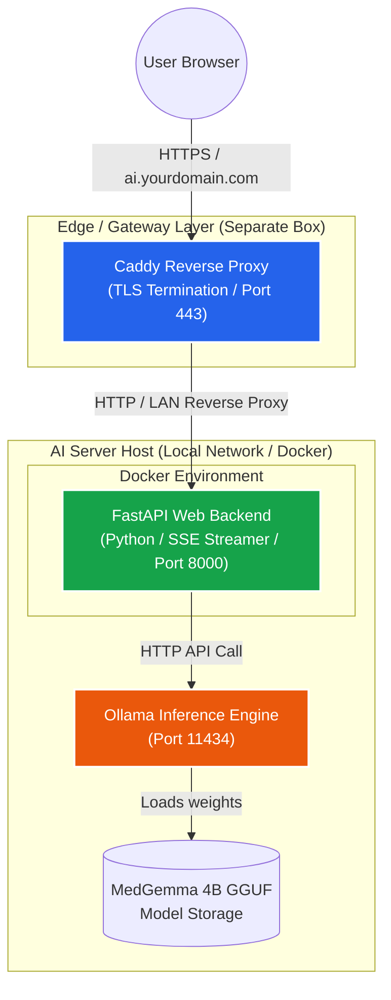
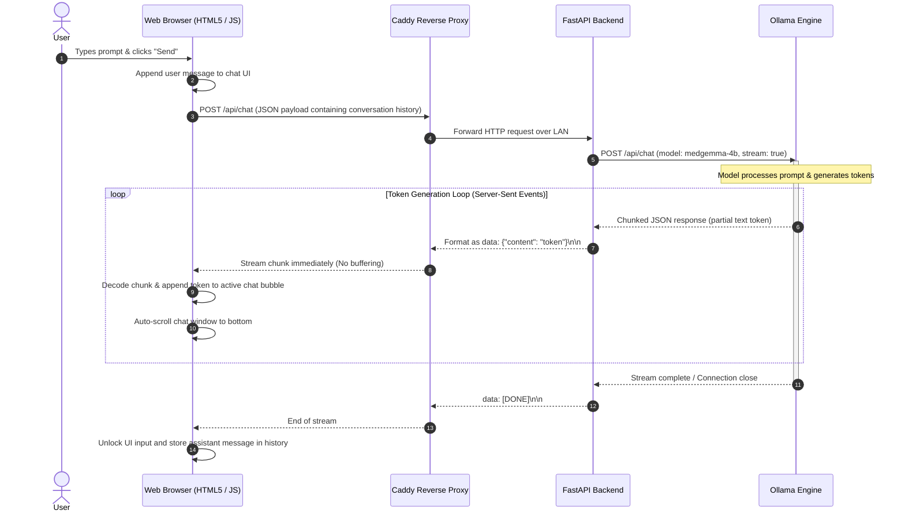

# Architecture Specification: Self-Hosted MedGemma AI Chat

## 1. Executive Summary

This document outlines the system architecture for a self-hosted, web-based AI chat application powered by the `google.medgemma-4b-it-GGUF` model via **Ollama**. The architecture decouples the frontend user interface and backend control logic from the reverse proxy and TLS termination layer, providing high portability, security, and low-latency local execution.

---

## 2. System Architecture Diagram

The architecture relies on a decoupled multi-host model where edge routing/SSL termination is isolated from compute and model inference.

---

## 3. Component Breakdown

### A. Edge / Gateway Layer (`Caddy`)

* **Role:** Acts as the public-facing gateway server. Handles automatic SSL/TLS certificate provisioning (Let's Encrypt), domain name mapping (`ai.yourdomain.com`), and secure public entry.
* **Network Behavior:** Proxies internal HTTP traffic across the local network/VPN to the application backend, configured with custom timeouts (`response_header_timeout 10m`) to prevent premature termination of long-lived streaming requests.

### B. Application Backend (`FastAPI / Python`)

* **Role:** Serves the static HTML/JS chat frontend, manages conversational payload preparation, and bridges client requests with the Ollama API.
* **Streaming Engine:** Implements `StreamingResponse` using asynchronous HTTP calls (`httpx.AsyncClient`) to consume chunked responses from Ollama and pipe them downstream as Server-Sent Events (SSE).
* **Headers:** Explicitly injects `X-Accel-Buffering: no` and `Cache-Control: no-cache` to ensure reverse proxies do not buffer token streams before sending them to the browser.

### C. Inference Engine (`Ollama`)

* **Role:** Manages GGUF model execution, context window management (`num_ctx`), prompt formatting, and token generation utilizing hardware-accelerated instructions.
* **Model Instance:** Registers `google.medgemma-4b-it-GGUF:Q4_K_M` via a custom Ollama `Modelfile`.

---

## 4. Request-Response Sequence Diagram

The diagram below details the end-to-end data flow when a user submits a prompt, showing how tokens are processed and streamed back in real-time.

---

## 5. Portability & Extensibility Guidelines

* **Swapping Inference Providers:** Because the FastAPI backend abstracts the LLM call into a standard HTTP payload, you can transition from local Ollama to a cloud provider (e.g., RunPod, vLLM, or DeepInfra) by modifying the `OLLAMA_URL` environment variable to point to an OpenAI-compatible endpoint.
* **Persistence Layer:** To upgrade from ephemeral in-memory conversation history to persistent storage, integrate a lightweight database (such as SQLite with SQLAlchemy or PostgreSQL) inside the FastAPI application layer.